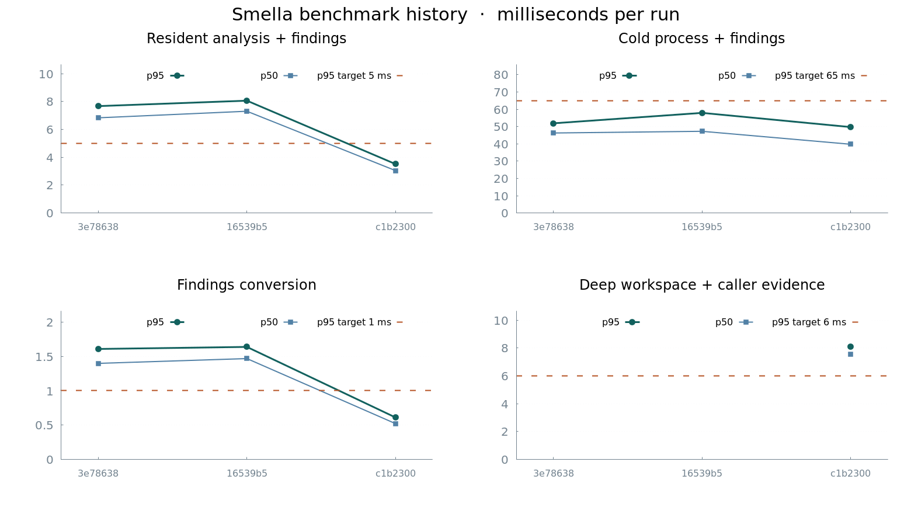

# Release goals and benchmark history

1. **Identify test-only code.** All seven spec acceptance cases must pass through the typed API on Node 24 and Bun. For a private helper, identify each retaining test file and distinguish value usage from type usage. Runtime, tooling, or public retention must suppress a test-only finding.
2. **Explain cross-workspace references with imperfect entries.** Resolve the deep-workspace fixture through nested manifests, aliases and barrels. Show the source and location of a caller with no root path, qualify the affected binding, and recover runtime evidence when the caller's entry is supplied. Keep unrelated negative conclusions independent. Unknown dynamic targets must qualify the broader scope they can affect.
3. **Improve measured end-to-end time.** Check latency, peak RSS and shipped package size against the versioned reference-machine targets. Record a run before and after optimizing the slowest measured stage. Each entry retains its active thresholds so later changes to the targets remain visible. [Targets](targets.json)

## Workloads

| Workload | What the timer includes | Correctness check |
| --- | --- | --- |
| Export chain | Analysis plus JS findings for 513 TypeScript files. Fresh-process timing also includes process launch, output and exit. | Exactly the same 512 file/export pairs as the fixture oracle and, when enabled, Knip. |
| Deep workspace | A fresh snapshot, findings, and a full private-binding explanation, in one resident process. The fixture has 32 packages, four nested workspace declarations above the package collection, 64 test roots and a missing caller entry. | All 64 value consumers and the ordered 32-package reference path must be present. |
| Native package | Compressed and unpacked file bytes of the actual JS and Linux x64 glibc tarballs. | The target-specific package must contain the native addon. |

Each latency series uses 20 samples and nearest-rank percentiles. The resident synthetic workloads use one warmup. Peak RSS on the export chain comes from the child process resource counters. Wall times use a warm filesystem. Hardware, kernel, toolchain, fixture version and Git revision are recorded in each run.

## Record progress

From a checkout with Rust 1.88+, Node 24, npm, and Gnuplot with the pngcairo terminal, run:

```sh
npm run bench:record
```

This builds the release addon, writes a timestamped JSON entry, refreshes the plot, and returns a nonzero status for a missed budget. Failed measurements stay in the history. Use `npm run bench:check` to measure without writing history, and `npm run bench:plot` to regenerate the PNG from existing entries. Git status is recorded so development runs are distinguishable from pinned clean revisions.

Set `KNIP_BIN` to the executable from a separate installation of Knip 6.48.0 with TypeScript 6.0.3 to run the matched comparison. The independent behavioral comparison uses `KNIP_BIN=/path/to/knip node scripts/compare-test-usage.mjs`.

The plot groups runs matching the most recent machine and toolchain. Points correspond to stored runs. Dashed lines show today's targets, and missing measurements stay blank. Historical entries predating the tracker carry their source. [Measurement entries](history/)


